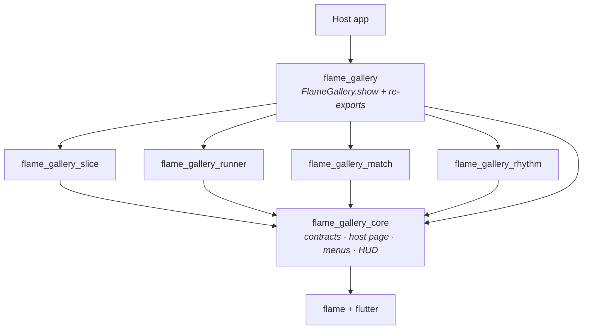
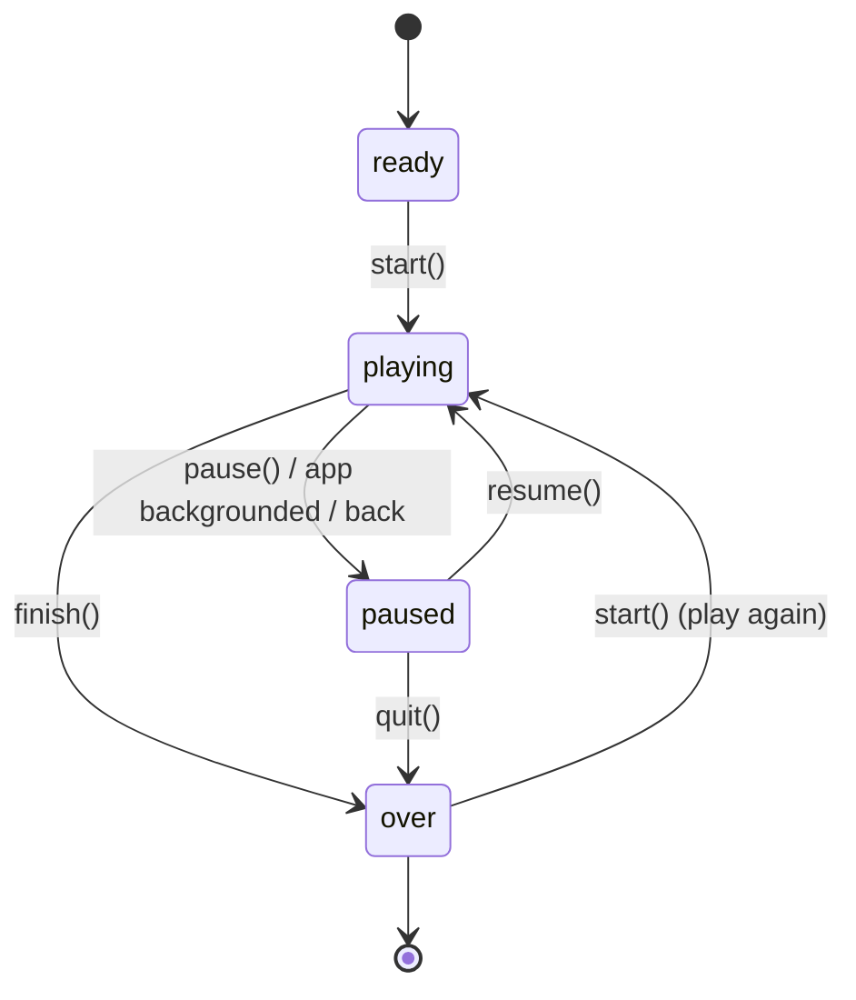
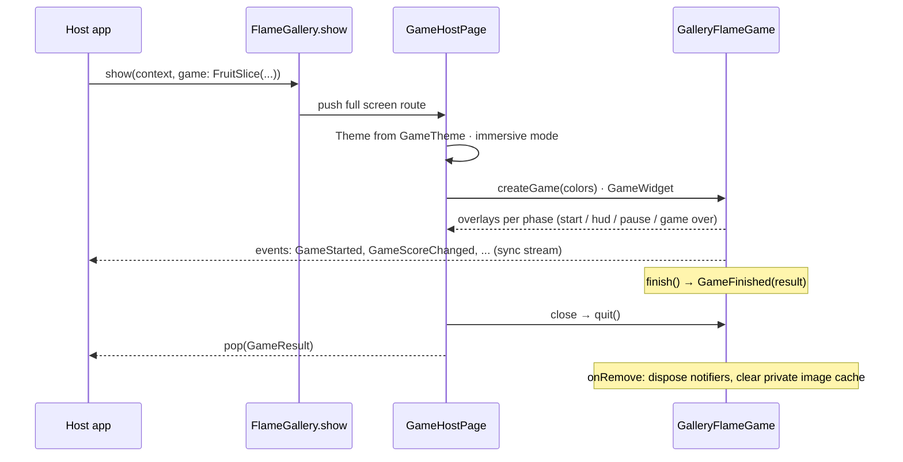
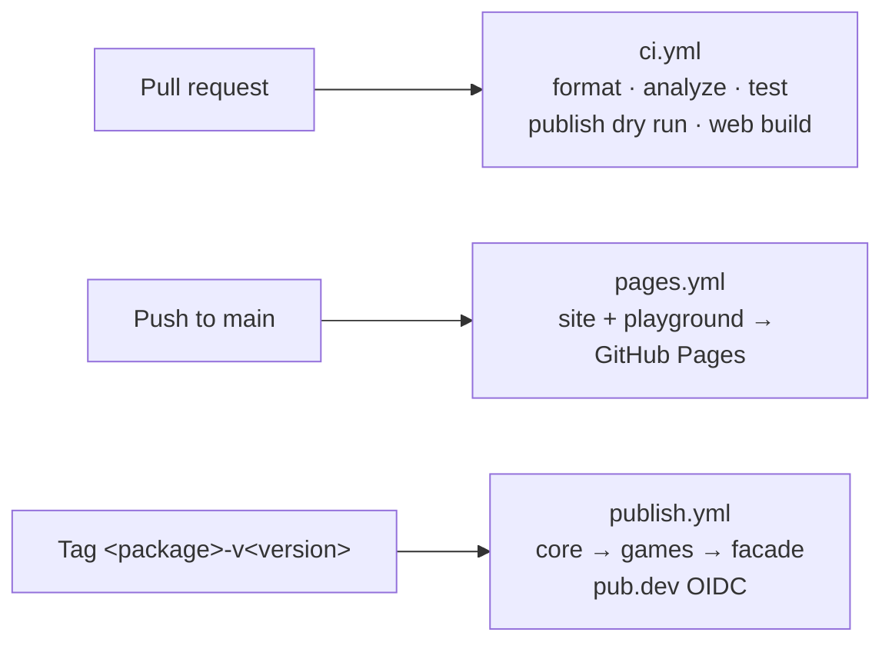

# Flame Gallery

[](https://github.com/VB10/flutter_flame_gallery/actions/workflows/ci.yml)
[](https://pub.dev/packages/flame_gallery)
[](LICENSE)

Drop-in, brandable 2D mini games for any Flutter app, built on [Flame](https://flame-engine.org).
One call opens a full screen game; you get the score back.

```dart
final result = await FlameGallery.show(context, game: const FruitSlice());
```

**[Website](https://vb10.github.io/flutter_flame_gallery/)** · **[Play in the browser](https://vb10.github.io/flutter_flame_gallery/play/)** · **[pub.dev](https://pub.dev/packages/flame_gallery)**

## The games

| | Game | Mechanic | The interesting part |
|---|---|---|---|
|  | **Fruit Slice**<br>`FruitSlice` | Swipe to slice fruit, chain combos in one stroke, avoid bombs. | Throws are planned from physics (`v = √(2gh)`) so every fruit peaks inside the screen; swipes are tested segment-vs-circle so fast strokes never skip a fruit; halves are the sprite split with `srcPosition`. |
|  | **Ruins Runner**<br>`EndlessRunner` | Three lanes: swipe to change lane, up to jump logs, down to slide under arches, collect coins. | The simulated step is clamped to 1/30 s so a jank frame cannot tunnel an obstacle through the hit window; a row planner guarantees a passable lane (tested over 50 seeds × 200 rows). |
|  | **Sweet Swap**<br>`SweetSwap` | Match three or more, cascades multiply points, move / time limits, target scores. | A pure Dart board produces `CascadeStep`s; Flame plays them through a stage queue (each stage returns its duration) with input locked; end conditions are evaluated only after the cascade settles. `seed` gives every player the same board. |
|  | **Note Rush**<br>`NoteRush` | Notes fall down four lanes; tap on the beat. Perfect / Great / Good windows, combos up to ×4. | Notes are positioned from the song clock, never from accumulated `dt`; the clock follows the music player's position (pluggable `RhythmAudio`) with `audioLatency` compensation. |

Every game takes a `GameTheme` (color scheme, font, logo), `GameStrings` (all texts, English and Turkish included) and its own immutable config.
Usage and configuration: [flame_gallery package README](packages/flame_gallery/README.md).

## Architecture

### Packages



| Package | Role | Depends on |
|---|---|---|
| [`flame_gallery`](packages/flame_gallery) | Facade: `FlameGallery.show` and every game. Most apps only need this. | core + all games |
| [`flame_gallery_core`](packages/flame_gallery_core) | `GalleryGame`, `GalleryFlameGame`, `GameHostPage`, overlays, `GameTheme`, `GameStrings`, `GameResult`, `GameEvent`, HUD widgets, shared effects, `GalleryKeys` | `flame`, `flutter` |
| `flame_gallery_<game>` | One package per game: [slice](packages/flame_gallery_slice), [runner](packages/flame_gallery_runner), [match](packages/flame_gallery_match), [rhythm](packages/flame_gallery_rhythm) | core, `flame`, `flutter` |
| [`apps/example`](apps/example) | Demo host app (iOS, Android, web), Maestro suite | `flame_gallery`, `flame_audio` |

Rules: games never import each other or the facade; library packages depend only on `flutter` and `flame` (no state management, codegen or audio packages forced on host apps). State is private `ValueNotifier`s exposed as `ValueListenable`s.

### The game contract

A game is two classes:

- **`GalleryGame<G>`** — the immutable, public description a host passes around: config + `GameTheme` + `GameStrings`. It creates a fresh Flame game per session (`createGame(colors)`) and builds its HUD.
- **`GalleryFlameGame`** — the Flame side. It owns the phase machine, the score, the overlays and the event stream. A game only implements `onRoundStart()` and calls `addScore()` / `finish()`; `collectStats()` adds numbers to the result.



### One session, end to end



Details that matter in production:

- **Images** load from a game-private `Images(prefix: '')` cache with `GameAsset.key`; the global `Flame.images` is never touched, and the private cache is cleared in `onRemove` (Flame only clears caches in `dispose()`, which `GameWidget` never calls).
- **Lifecycle**: backgrounding pauses through the phase machine (so Flame does not auto-resume into a paused menu); the engine stops 0.8 s after game over to save battery.
- **System UI**: games run in `immersiveSticky` and restore `edgeToEdge`; `FlameGallery.show(immersive: false)` opts out.
- **Events** are a synchronous broadcast stream, so the quit result emitted during teardown still reaches the host.

### Inside a game package

```text
lib/
  flame_gallery_<game>.dart   public exports only
  src/<public_name>.dart      the GalleryGame subclass (FruitSlice, ...)
  src/config/                 immutable config, items, difficulty enum
  src/logic/                  pure Dart rules and math, unit tested
  src/component/              Flame components, one per file
  src/game/<game>_game.dart   GalleryFlameGame subclass, orchestration only
  src/view/                   Flutter HUD
  src/testing/                Semantics ids for UI tests
assets/images/                generated, IP-clean placeholder sprites
```

## Testing

| Layer | Tool | What it covers |
|---|---|---|
| Rules and math | `test` | Launch physics, segment hit test, combo rules, row planner guarantees, match board generation / cascades / reshuffle, rhythm timing windows, song timeline |
| Game flow | `flame_test` | Phases, scoring, end conditions, audio call order, deterministic runs with injected `Random(seed)` |
| End to end | [Maestro](apps/example/maestro) | Every game on a real iOS simulator and Android emulator: menus, pause, HUD values, exact scores (seeded Sweet Swap board → 210 after a 3-level cascade), results reaching the host |

124 unit and game tests; 7 Maestro flows passing on iPhone 17 and Pixel 7a.
Menus and HUD values carry `Semantics(identifier:)` values from `GalleryKeys` (plus `RunnerKeys`, `MatchKeys`, `RhythmKeys`) so host apps can drive the games from their own UI tests.

## Development

Pub workspace + [Melos](https://melos.invertase.dev).

```bash
flutter pub get
melos run analyze
melos run test
cd apps/example && flutter run            # or F5 in VS Code
melos run e2e:ios                         # Maestro smoke suite on a simulator
melos run e2e:android                     # ... or an emulator
```

Architecture rules, the game contract and testing notes live in [CLAUDE.md](CLAUDE.md).
New games: copy the shape of `packages/flame_gallery_slice` (or ask Claude Code for the `add-game` skill).

## Releasing



Every package is versioned and tagged on its own (`flame_gallery_core-v0.1.0`, ...). The first version of each package is published by hand; later versions publish from tags through pub.dev automated publishing (no secrets).

## Roadmap

- `flame_gallery_native`: embed the games in native iOS / Android apps (Flutter add-to-app + platform channel, `GameResult.toJson()` as payload), including Android side-gesture exclusion.
- Golden tests for menus and HUD; on-device profiling in profile mode.
- More games.

## License

[MIT](LICENSE)
