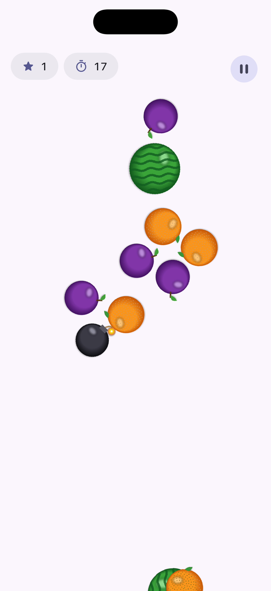
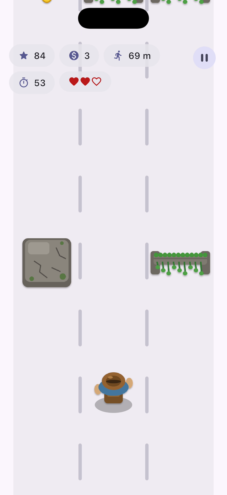
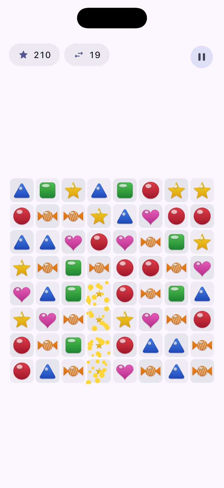
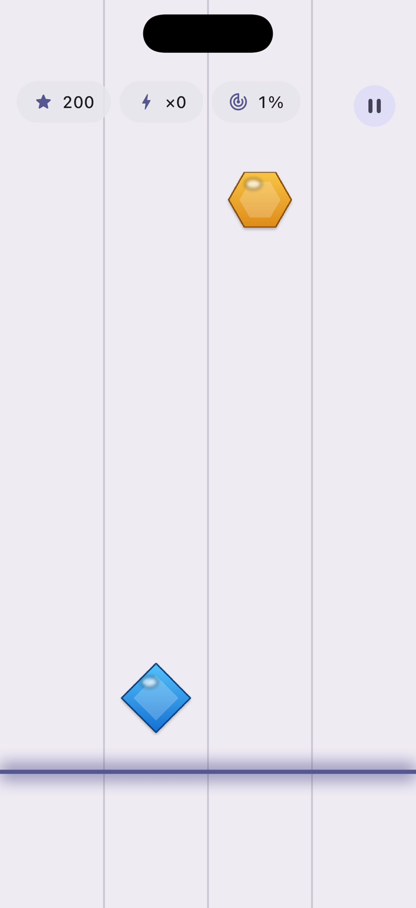

# Flame Gallery

[](https://github.com/VB10/flame_gallery/actions/workflows/ci.yml)
[](https://pub.dev/packages/flame_gallery)
[](LICENSE)

Drop-in, brandable 2D mini games for any Flutter app, built on [Flame](https://flame-engine.org).

```dart
final result = await FlameGallery.show(context, game: const FruitSlice());
```

**[Website](https://vb10.github.io/flame_gallery/)** · **[Play in the browser](https://vb10.github.io/flame_gallery/play/)** · **[pub.dev](https://pub.dev/packages/flame_gallery)**

| Fruit Slice | Ruins Runner | Sweet Swap | Note Rush |
|:---:|:---:|:---:|:---:|
|  |  |  |  |

Usage, configuration and results are documented in the
[flame_gallery package README](packages/flame_gallery/README.md).

## Packages

| Package | What it is |
|---|---|
| [`flame_gallery`](packages/flame_gallery) | Facade: `FlameGallery.show` + every game. Most apps only need this. |
| [`flame_gallery_core`](packages/flame_gallery_core) | Contracts (`GalleryGame`, `GalleryFlameGame`), host page, menus, HUD widgets, `GalleryKeys`. |
| [`flame_gallery_slice`](packages/flame_gallery_slice) | Fruit Slice (`FruitSlice`) |
| [`flame_gallery_runner`](packages/flame_gallery_runner) | Ruins Runner (`EndlessRunner`) |
| [`flame_gallery_match`](packages/flame_gallery_match) | Sweet Swap (`SweetSwap`) |
| [`flame_gallery_rhythm`](packages/flame_gallery_rhythm) | Note Rush (`NoteRush`) |
| [`apps/example`](apps/example) | Demo host app (iOS, Android, web) and the Maestro suite |

Library packages depend only on `flutter` and `flame`.

## Development

Pub workspace + [Melos](https://melos.invertase.dev).

```bash
flutter pub get
melos run analyze
melos run test
cd apps/example && flutter run            # or F5 in VS Code
melos run e2e:ios                         # Maestro smoke suite on a simulator
melos run e2e:android                     # ... or an emulator
```

Architecture rules, the game contract and testing notes live in [CLAUDE.md](CLAUDE.md).
New games: copy the shape of `packages/flame_gallery_slice`.

## Releasing

Every package is versioned and tagged on its own (`<package>-v<version>`, e.g. `flame_gallery_core-v0.1.0`).
Pushing a tag runs [publish.yml](.github/workflows/publish.yml), which publishes through pub.dev automated publishing (OIDC, no secrets).
Order: `flame_gallery_core` → games → `flame_gallery`. The first version of each package has to be published by hand.

The website and browser playground deploy to GitHub Pages from `main` ([pages.yml](.github/workflows/pages.yml)).

## License

[MIT](LICENSE)
